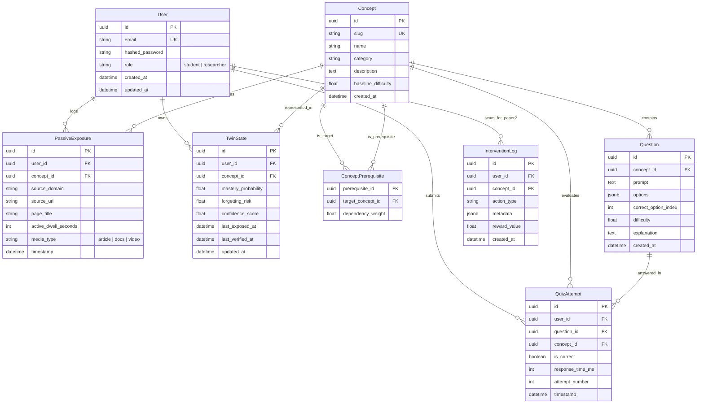

# Cognitwin — Project Specification & Architecture

> **Document Version:** 1.0.0-PROD  
> **Status:** Grounding / Architecture Freeze  
> **Target Scope:** Paper 1 Build Scope (with Paper 2 Seam Hooks)  
> **Last Updated:** 2026-11-21

---

## 1. Executive Summary & Vision

Traditional online learning platforms present static syllabi and one-size-fits-all curricula. They treat all students identically, ignoring individual mastery curves, uneven learning speeds, hidden prerequisite gaps, and human memory decay (the Ebbinghaus forgetting curve).

**Cognitwin** introduces an **Adaptive Cognitive Digital Twin for Personalized Learning**. It constructs a personalized, dynamic graph representation of a learner's cognitive state as they study technical concepts online. By coupling a privacy-first browser extension with a Graph Neural Network Knowledge Tracing (GNN-KT) model, Cognitwin tracks concept exposure, computes real-time forgetting risks, and triggers hyper-targeted active verification checks at critical cognitive junctions.

---

## 2. Research Split & Scope Boundaries

Our research and product roadmap is divided into two distinct publications. **This repository's immediate build scope is strictly Paper 1.**

```
+---------------------------------------------------------------------------------+
|                               COGNITWIN SYSTEM                                  |
+---------------------------------------+-----------------------------------------+
|    PAPER 1: ACTIVE BUILD SCOPE        |      PAPER 2: FUTURE SEAM HOOKS         |
|                                       |       (DO NOT IMPLEMENT YET)            |
|  - Dual-Signal Telemetry Pipeline     |  - Deep Reinforcement Learning Policy   |
|    * Passive Exposure (Extension)     |    (Optimal intervention scheduling)    |
|    * Active Verification (Quizzes)    |  - LLM Personalized Content Generation  |
|  - Graph-based Knowledge Tracing      |    (On-the-fly remedial explanations)   |
|    (PyTorch Geometric GNN-KT)         |  - Multi-armed bandit concept selection |
|  - Live Digital Twin Visualization    |                                         |
|    (React Flow dynamic graph)         |  [SEAM CONTRACTS DEFINED ONLY]          |
|  - Paper 1 Evaluation Engine          |  - DB: `interventions` audit table      |
|    (AUC, RMSE, Mastery Trajectories)  |  - API: `/api/v1/interventions/policy`  |
+---------------------------------------+-----------------------------------------+
```

### Paper 1 Responsibilities (Current Target)
1. **Passive Study Exposure**: Chrome extension captures focused study time on technical materials without storing personal data.
2. **Active Ground-Truth Verification**: Rapid in-app 2-minute micro-checks (2–3 questions) assessing foundational prerequisites.
3. **Graph-based Knowledge Tracing (GNN-KT)**: Message passing over a directed concept prerequisite graph to model mastery propagation and temporal decay.
4. **Live Digital Twin Dashboard**: Student-facing React Flow graph showing real-time node health (Mastered, Active, Fading, At-Risk).
5. **Researcher Evaluation Module**: Benchmark panel computing ROC-AUC, RMSE, and prediction horizon metrics on test datasets.

---

## 3. Dual-Signal Telemetry Architecture

Cognitwin reconciles the tension between passive consumption (reading documentation, watching lectures) and active retrieval (answering problems) through a mathematically sound dual-signal pipeline.

```
       [Technical Web Article / Video]
                      |
                      | (Focused dwell time)
                      v
      +--------------------------------+
      |  apps/extension (Manifest V3)  |
      |   Study Mode: ON / Active Tab  |
      +--------------------------------+
                      |
                      | POST /api/v1/telemetry/passive (Batched JSON)
                      v
      +--------------------------------+
      |      services/api (FastAPI)    |
      +--------------------------------+
             /                  \
            /                    \  POST /api/v1/telemetry/attempts
           v                      v
  [Passive Exposure Log]   [Quiz Attempt Log] <--- [apps/web In-App Quiz]
           \                      /
            \                    /
             v                  v
      +--------------------------------+
      |    services/gnn_kt (PyG)       |
      |  - Prerequisite Message Passing|
      |  - Temporal Forgetting Decay   |
      +--------------------------------+
                      |
                      v
             [TwinState Updates]
                      |
                      v
      +--------------------------------+
      |   apps/web Live Graph (Flow)   |
      |  - Emerald: Mastered (>=85%)   |
      |  - Sky: Active (60-84%)        |
      |  - Amber: Fading (Review Due)  |
      |  - Crimson: Prerequisite Gap   |
      +--------------------------------+
```

### Signal 1: Passive Study Exposure (`passive_exposure`)
- **Source**: Chrome Extension (Manifest V3).
- **Behavior**: Tracks active focus time (window active, user not idle $>60$ seconds) on whitelisted technical domains (e.g., GitHub, arXiv, docs.python.org, technical YouTube videos).
- **Mathematical Impact**:
  - Passive exposure acts as an attenuation factor on the Ebbinghaus forgetting curve:
    $$R(t) = \exp\left(-\frac{t}{S + \alpha \cdot \log(1 + D_{\text{focus}})}\right)$$
    where $t$ is elapsed time since last verification, $S$ is foundational stability, and $D_{\text{focus}}$ is passive dwell time.
  - **Critical Rule**: Passive exposure **never** directly increases verified mastery probability beyond an unverified threshold ceiling (capped at $\max 0.65$ without active verification).

### Signal 2: Active Verification (`quiz_attempt`)
- **Source**: In-App Quick Checks in `apps/web`.
- **Behavior**: 2-minute micro-checks (2–3 targeted multiple-choice or short-response items) triggered when model uncertainty or forgetting risk is elevated.
- **Mathematical Impact**:
  - Serves as the ground truth label $y \in \{0, 1\}$ for GNN-KT supervised training.
  - Generates direct Bayesian updates to the concept node embedding and updates prerequisite/successor node states through GNN graph convolution.

---

## 4. Core Data Entities & Database Schema

The database is built on PostgreSQL 16 using async SQLAlchemy 2.0.



### Telemetry API Contracts

#### `POST /api/v1/telemetry/passive`
Batched sync from Chrome extension:
```json
{
  "events": [
    {
      "url": "https://raft.github.io/",
      "domain": "raft.github.io",
      "title": "Raft Consensus Algorithm",
      "dwell_time_seconds": 184,
      "media_type": "article",
      "timestamp": "2026-11-21T14:32:00Z"
    }
  ]
}
```
*Response: `202 Accepted` with processed concept IDs mapped from URLs.*

#### `POST /api/v1/telemetry/attempts`
Quick check submission:
```json
{
  "question_id": "4b6c31bf-...",
  "concept_id": "89e1a84f-...",
  "selected_option_index": 2,
  "response_time_ms": 14200,
  "attempt_number": 1
}
```
*Response: `200 OK` with `{ "is_correct": true, "updated_mastery": 0.88, "forgetting_risk": 0.12, "explanation": "..." }`.*

#### `GET /api/v1/twin/graph`
Returns student's live Knowledge Graph for React Flow rendering:
```json
{
  "nodes": [
    {
      "id": "concept-raft",
      "label": "Raft Consensus",
      "category": "Distributed Systems",
      "mastery_probability": 0.82,
      "forgetting_risk": 0.18,
      "status": "active_stable",
      "last_verified_at": "2026-11-20T10:15:00Z"
    }
  ],
  "edges": [
    {
      "id": "e-paxos-raft",
      "source": "concept-paxos",
      "target": "concept-raft",
      "weight": 0.95
    }
  ],
  "summary": {
    "mastered_count": 8,
    "active_count": 12,
    "fading_count": 3,
    "at_risk_count": 1
  }
}
```

---

## 5. Monorepo Structure

```
cognitwin/
├── .github/
│   └── workflows/
│       ├── web.yml             # Triggers only on apps/web/**
│       ├── extension.yml       # Triggers only on apps/extension/**
│       ├── api.yml             # Triggers only on services/api/**
│       └── gnn.yml             # Triggers only on services/gnn_kt/**
├── apps/
│   ├── web/                    # React 18/19 + Vite + TypeScript + Tailwind
│   │   ├── src/
│   │   │   ├── components/     # Landing, Auth, TwinGraph, QuizModal, UI
│   │   │   ├── hooks/          # useAuth, useTwinGraph, useQuickCheck
│   │   │   ├── pages/          # LandingPage, LoginPage, Dashboard, ResearchPage
│   │   │   ├── services/       # api.ts (Vite proxy /api/* client)
│   │   │   └── types/          # Shared frontend data models
│   │   ├── package.json
│   │   └── vite.config.ts
│   └── extension/              # Manifest V3 Chrome Extension
│       ├── src/
│       │   ├── background/     # Service worker: focus tracker, alarm batching
│       │   ├── content/        # Title extractor, YouTube time listener
│       │   ├── popup/          # Study Mode ON/OFF switch, domain blocklist UI
│       │   └── shared/         # Storage keys, telemetry packet models
│       ├── manifest.json
│       └── package.json
├── services/
│   ├── api/                    # FastAPI Backend
│   │   ├── app/
│   │   │   ├── core/           # Config, database, security, dependencies
│   │   │   ├── models/         # SQLAlchemy 2.0 async models
│   │   │   ├── schemas/        # Pydantic v2 schemas
│   │   │   ├── routers/        # auth, telemetry, twin, research
│   │   │   └── services/       # Concept mapper, scoring, GNN client
│   │   ├── tests/              # pytest async test suite
│   │   ├── pyproject.toml
│   │   └── Dockerfile
│   └── gnn_kt/                 # PyTorch Geometric Inference & Eval
│       ├── model/              # GNN-KT architecture (GCN/GAT + GRU/LSTM)
│       ├── data/               # Graph builder, seed concepts, benchmark split
│       ├── evaluation/         # AUC, RMSE, ROC curve calculation
│       ├── server.py           # Lightweight internal inference endpoint
│       └── pyproject.toml
├── docs/
│   ├── PROJECT_SPEC.md         # This specification document
│   └── DESIGN_SYSTEM.md        # Stitch-aligned design specifications
├── AGENTS.md                   # Agent operating rules (at repo root)
├── docker-compose.yml          # PostgreSQL 16 + Local API + GNN services
├── .env.example                # Root environment template
└── README.md                   # Quickstart guide (< 5 min setup)
```

---

## 6. Cold-Start Strategy & Resilience

To avoid empty-tensor crashes in PyTorch Geometric and broken dashboard graphs when a new student registers:

1. **Deterministic Default State**:
   - Upon user registration, a database trigger or auth service hook seeds a standard baseline `TwinState` record for every core concept in the root taxonomy.
   - Initial parameters:
     - $P(\text{mastery}) = 0.50$ (uninformed neutral prior).
     - $\text{forgetting\_risk} = 0.00$.
     - $\text{confidence\_score} = 0.10$ (low confidence flag).
2. **PyG Graph Builder Safety**:
   - The graph constructor checks for zero-interaction nodes and fills input feature vectors with $[0.5, 0.0, 0.0]$ instead of empty slices.
   - Self-loops are automatically appended using `torch_geometric.utils.add_self_loops` so node degree is never zero.
3. **Frontend Fallback**:
   - If a student has no quiz attempts, the dashboard displays an onboarding banner: *"Baseline Knowledge Graph Initialized. Complete a 2-minute quick check or browse technical docs with Study Mode ON to calibrate your twin."*

---

## 7. Phased Execution Plan & Strict Exit Gates

```
Phase 1: Foundation & Monorepo Skeleton
  |
  +--> Exit Gate 1: Docker up, CI workflows passing, linters green.
  |
Phase 2: Auth, RBAC & Landing Page
  |
  +--> Exit Gate 2: JWT HTTP-only cookies verified; Landing page matches Stitch.
  |
Phase 3: Manifest V3 Chrome Extension
  |
  +--> Exit Gate 3: Extension captures focus, respects blocklist, syncs to API.
  |
Phase 4: Concept Catalog & Quick Verification Checks
  |
  +--> Exit Gate 4: Concept graph seeded, URL mapper active, in-app quiz updates logs.
  |
Phase 5: PyG GNN-KT Service & Live Digital Twin
  |
  +--> Exit Gate 5: Live React Flow graph updates, Researcher view computes AUC/RMSE.
```

### Phase 1: Foundation, Infrastructure & Monorepo Skeleton
- **Deliverables**:
  - Root monorepo directory layout with `package.json` workspaces or clean directory isolation.
  - `docker-compose.yml` for PostgreSQL 16 with health checks.
  - Path-filtered GitHub Actions (`web.yml`, `extension.yml`, `api.yml`, `gnn.yml`).
  - Python project tooling (`pyproject.toml`, `ruff`, `pytest`) and TypeScript configs.
  - Health check endpoint `GET /api/v1/health` returning database connectivity status.
- **Exit Criteria**:
  - `docker compose up -d` starts PostgreSQL cleanly.
  - `pytest` passes with 100% success on health check tests.
  - `pnpm lint` or `npm run lint` passes with zero errors.
  - CI workflows verified with dry-run/local check.

### Phase 2: Landing Page, Auth & Role-Based Access Control
- **Deliverables**:
  - Academic-modern Landing Page adhering strictly to `docs/DESIGN_SYSTEM.md` and Stitch designs.
  - Sign In / Sign Up modal and pages with input validation.
  - FastAPI auth router issuing signed JWTs in HTTP-only, Secure, SameSite=Lax cookies.
  - RBAC dependencies protecting `student` and `researcher` routes.
- **Exit Criteria**:
  - Full automated auth lifecycle test: register -> login -> set cookie -> access protected route -> logout -> unauthenticated 401.
  - Responsive landing page validated against Stitch reference layout.

### Phase 3: Manifest V3 Chrome Extension (Passive Study Engine)
- **Deliverables**:
  - TypeScript Chrome Extension (Manifest V3).
  - Study Mode ON/OFF physical-style toggle in popup.
  - Active focus tracker (`chrome.idle` and window focus listeners; ignores background tabs).
  - Domain blocklist management in Chrome `storage.sync`.
  - Batched background alarm syncing telemetry to `POST /api/v1/telemetry/passive`.
- **Exit Criteria**:
  - Extension builds without TypeScript errors.
  - Verified active focus dwell calculation (does not accrue time when tab is backgrounded or user is idle $>60$s).
  - Batched sync successfully inserts `PassiveExposure` records in PostgreSQL.

### Phase 4: Concept Catalog, URL Mapper & In-App Quick Checks
- **Deliverables**:
  - Seeded technical Knowledge Graph (Distributed Systems: CAP theorem, Paxos, Raft, Vector Clocks, Byzantine Faults, etc.).
  - URL and page title regex/keyword concept mapper.
  - In-app 2-minute Quick Verification Quiz component in `apps/web`.
  - Telemetry endpoint `POST /api/v1/telemetry/attempts` calculating correctness, speed, and recording `QuizAttempt`.
- **Exit Criteria**:
  - Concept mapper maps sample URLs/titles to concept taxonomy with $>90\%$ accuracy.
  - Submitting quiz attempt updates database and returns instant diagnostic feedback.

### Phase 5: PyTorch Geometric GNN-KT Model, Live Graph & Researcher Panel
- **Deliverables**:
  - PyTorch Geometric GNN-KT model with prerequisite message passing and forgetting decay.
  - Inference service calculating dynamic mastery probabilities and forgetting risks.
  - Interactive React Flow Digital Twin graph displaying color-coded concept states.
  - Researcher evaluation dashboard displaying Paper 1 benchmark metrics: ROC-AUC, RMSE, and learning curve comparisons.
- **Exit Criteria**:
  - GNN-KT inference produces valid probability tensors $\in [0.0, 1.0]$ with cold-start fallback.
  - React Flow nodes update live upon telemetry ingestion.
  - Researcher evaluation route successfully calculates AUC and RMSE on test split data.

---

*This document serves as the architectural contract for Cognitwin Paper 1.*
